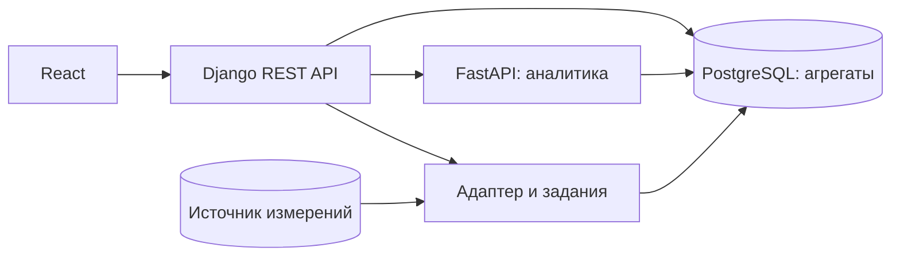

# Smart Energy Monitoring

**Веб-система мониторинга энергопотребления: от показаний датчиков до агрегатов, аналитики и отчётов.**

React · Django REST Framework · FastAPI · PostgreSQL · Docker

Публичная версия учебного командного проекта. В репозитории собраны компоненты приложения и изолированные тестовые сценарии. Код показывает обработку источников, проверку качества данных, почасовые/суточные агрегации, интерфейс мониторинга и сравнение периодов.

## Получить проект

```bash
git clone https://github.com/Ilush1k/smart-energy-monitoring.git
cd smart-energy-monitoring
```

## Возможности

- Авторизация, профиль пользователя и JWT-сессии с refresh-cookie.
- Дашборд мощности и энергии, фильтры, временные ряды и сравнение объектов.
- Подключение источников через серверные профили и сопоставление полей.
- Проверка схем, интервалов измерения и полноты данных до агрегации.
- Предварительный просмотр, задания, расписание и транзакционное обновление агрегатов.
- Отдельный сервис сравнения периодов и Z-тест.
- Персональные настройки уведомлений и отчёты.

## Архитектура



| Компонент | Каталог |
|---|---|
| Frontend | `Фронт/smart_energy` |
| Gateway и пользователи | `Бэк/project_backend` |
| Аналитический сервис | `Аналитический сервис/Analytical_service` |
| Загрузка, валидация, агрегации | `adapter` |

## Быстрая проверка на изолированной базе

Нужны Docker и Docker Compose. Из корня:

```bash
docker compose -p portfolio-energy-check -f compose.tests.yml run --build --rm tests
docker compose -p portfolio-energy-check -f compose.tests.yml down
```

Compose создаёт отдельный PostgreSQL с тестовыми данными и не использует рабочие `.env`. Проверки охватывают адаптер, backend, аналитику и согласованность потребителей энергии.

## Локальные проверки компонентов

Python 3.12 для адаптера; Python 3.11/3.12 для аналитики и Django. Создайте отдельное окружение и установите requirements нужного компонента.

```bash
python -m pip install -r adapter/requirements.txt
python -m unittest discover -s adapter/tests -v
```

Интеграционные проверки без `ADAPTER_TEST_ADMIN_DSN` пропускаются. Для PostgreSQL используйте только изолированный тестовый экземпляр: fixtures создают и очищают тестовые таблицы.

Frontend, Node.js 22.12+:

```bash
cd Фронт/smart_energy
npm ci
npm run test:mapping
npm run test:dashboard
npm run lint
npm run build
```

## Запуск приложения

[Руководство по конфигурации и запуску](docs/SETUP.md) описывает окружения, порядок старта и требования к PostgreSQL. Одни Django-миграции не создают схему внешних измерений и агрегатов. Для полноценного дашборда нужна подготовленная база и данные либо изолированная демонстрация из руководства.

## Материалы и границы публичной версии

- [Контракты и поток данных](docs/ARCHITECTURE.md).
- [Запуск и конфигурация](docs/SETUP.md).
- [Описание состава проекта](docs/PROJECT_SCOPE.md).

Рабочие подключения, ключи, база измерений и история закрытой рабочей копии не включены. Публикация подготовлена как самостоятельный снимок кода. Найденный ранний Word-отчёт содержит незаполненные поля и описание этапа постановки задачи, поэтому вместо него добавлена документация по текущей реализации.

GitHub: [Ilush1k](https://github.com/Ilush1k). Проект командный; этот репозиторий не приписывает все компоненты одному участнику.
